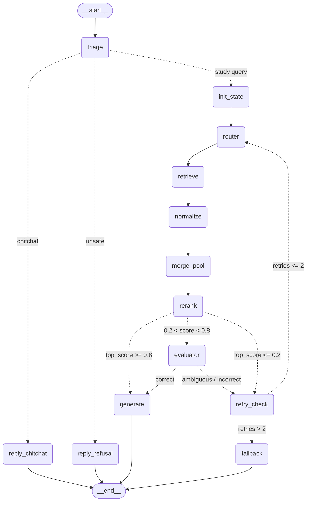

# Corrective RAG (CRAG) Pipeline Documentation

This document outlines the architecture, execution workflow, node contracts, and core configuration settings for the Corrective RAG (`CRAG`) engine in Study Buddy.

---

## 1. Pipeline Graph

  
   
  <em>(Click graph to open full resolution)</em>

View raw Mermaid specification

---

## 2. End-to-End Workflow

The pipeline processes user queries through three distinct pathways:

1. **Zero-Retrieval Fast Paths (Bypass)**:
   - Evaluated at `triage` via Tier 0 (regex/rules, `<1ms`) and Tier 1 (fast LLM classification, line-based output).
   - If `chitchat`: routes directly to `reply_chitchat` with localized canned greetings/thanks and exits.
   - If `unsafe`: routes directly to `reply_refusal` with policy refusals (gibberish, NSFW, politics, religion) and exits.

2. **Standard RAG Pipeline (Happy Path)**:
   - Initialized at `init_state` (passes `intent` and sub-queries, sets `retries=0`).
   - `router` selects search sources and formulates query plans (defaults to curated Supabase materials on pass 0).
   - `retrieve` executes external tool queries (Supabase vector store, Wikipedia, ArXiv, Web).
   - `normalize` cleans text into structured `Chunk` objects and computes SHA-256 content IDs.
   - `merge_pool` deduplicates passages and merges them into the cumulative pool.
   - `rerank` scores chunks using a cross-encoder (`jina-reranker-v2-base-multilingual`), pinning top Supabase passages.
   - If top reranker score $\ge 0.8$ (`HIGH_THRESHOLD`), `score_gate` short-circuits directly to `generate` (skipping the evaluator LLM call).
   - `generate` drafts an educational answer strictly cited with chunk numbers `[n]`.

3. **Evaluation & Corrective Feedback Loop**:
   - If rerank score is between $0.2$ and $0.8$, `evaluator` inspects relevance and coverage (`correct`, `ambiguous`, `incorrect`).
   - If evaluated as `correct`, proceeds to `generate`.
   - If `ambiguous` or `incorrect`, `retry_check` tracks attempt count.
   - If `retries <= MAX_RETRIES (2)`, loops back to `router` to re-query (`bad_query` rewrites query targeting `missing`; sources remain fixed with no tool escalation).
   - If retries are exhausted, routes to `fallback` (synthesizes hybrid response or general-knowledge answer with `low_confidence=True`).

---

## 3. Node Specifications & Outputs

### 1. `triage`
- **Purpose**: Classifies user input into intent (`chitchat`, `unsafe`, `simple`, `complex`) and decomposes complex queries into 1–3 sub-queries. Runs Tier 0 regex heuristics first, falling back to a structured line-based LLM call.
- **Output fields**:
  - `intent`: `"chitchat" | "unsafe" | "simple" | "complex"`
  - `sub_questions`: `list[str]` (non-empty only for complex)
  - `reply`: canned string for chitchat/unsafe, otherwise `None`

### 2. `reply_chitchat`
- **Purpose**: Emits immediate conversational response in English or Arabic without touching vector stores or tools.
- **Output fields**:
  - `answer`: localized greeting/thanks message
  - `citations`: `[]`
  - `low_confidence`: `False`

### 3. `reply_refusal`
- **Purpose**: Emits standardized safety refusal for out-of-scope queries (gibberish, adult, politics, religion).
- **Output fields**:
  - `answer`: standardized refusal string
  - `citations`: `[]`
  - `low_confidence`: `False`

### 4. `init_state`
- **Purpose**: Initializes graph state variables for legitimate study queries.
- **Output fields**:
  - `original_q`: validated question string
  - `sources_to_use`: `["supabase"]` (default first pass)
  - `retries`: `0`, `pool`: `[]`, `ranked`: `[]`, `verdict`: `None`

### 5. `router`
- **Purpose**: Selects target retrieval sources and constructs retrieval queries.
  - **Pass 0**: If triage `intent == "complex"`, queries **all tools concurrently** (`supabase`, `arxiv`, `wikipedia`, `web`) with zero LLM delay. If `intent == "simple"`, runs **automatic tool calling** via LangChain agentic tool selection.
  - **Retries**: Keeps existing sources fixed (no adding tools / no tool escalation); strictly performs **requerying** by rewriting queries targeting evaluator `missing` feedback.
- **Output fields**:
  - `sources_to_use`: list of sources (`["supabase", "arxiv", "wikipedia", "web"]`)
  - `search_query`: optimized search keywords
  - `tool_queries`: mapping of source to specific search query

### 6. `retrieve`
- **Purpose**: Calls registered tool functions concurrently across designated sources.
- **Output fields**:
  - `raw_results`: raw documents/payloads returned by tool APIs

### 7. `normalize`
- **Purpose**: Parses varied tool response formats, splits text into target chunk lengths, and computes deterministic content hashes.
- **Output fields**:
  - `new_chunks`: list of validated `Chunk` instances
  - `tried_sources`: updated cumulative list of queried sources

### 8. `merge_pool`
- **Purpose**: Accumulates incoming chunks into the existing pool, preserves scores, and ensures top-tier document slots are retained without unbounded growth.
- **Output fields**:
  - `pool`: deduped, bounded chunk list (capped at `POOL_MAX`)

### 9. `rerank`
- **Purpose**: Scores chunks against `original_q` using a cross-encoder model. Retains top Supabase chunks to preserve course material grounding.
- **Output fields**:
  - `ranked`: top candidate chunks sorted by descending score (length `FINAL_CONTEXT_N`)

### 10. `evaluator`
- **Purpose**: Fast LLM judge checking context relevance and completeness against the question. Emits line-based key-values (`VERDICT`, `CAUSE`, `MISSING`). The only cause for retrying is `bad_query` (requerying).
- **Output fields**:
  - `verdict`: `"correct" | "ambiguous" | "incorrect"`
  - `likely_cause`: `"none" | "bad_query"`
  - `missing`: description of missing factual concepts

### 11. `retry_check`
- **Purpose**: Increments retry counter and records diagnostic logs.
- **Output fields**:
  - `retries`: updated integer counter (`retries + 1`)

### 12. `generate`
- **Purpose**: Synthesizes the final educational answer strictly grounded in ranked context chunks cleanly without bracketed numbers (`[1]`, `[2]`).
- **Output fields**:
  - `answer`: synthesized text
  - `citations`: list of cited source titles/URLs
  - `low_confidence`: `False`

### 13. `fallback`
- **Purpose**: Failsafe generator triggered when retries are exhausted or retrieval fails. Generates hybrid context-assisted or knowledge-based explanations.
- **Output fields**:
  - `answer`: fallback educational text
  - `citations`: list of citations (if partial context was used)
  - `low_confidence`: `True`

---

## 4. Conditional Edge Gates

- **`triage_gate`**:
  - `intent == "chitchat"` $\rightarrow$ `reply_chitchat`
  - `intent == "unsafe"` $\rightarrow$ `reply_refusal`
  - default $\rightarrow$ `init_state`

- **`score_gate`**:
  - **For Simple Queries (`intent == "simple"`)**:
    - `top_score > LOW_THRESHOLD (0.2)` $\rightarrow$ `generate` (bypasses evaluator entirely for both mid and high scores to eliminate token waste).
    - `top_score <= LOW_THRESHOLD (0.2)` $\rightarrow$ `retry_check` $\rightarrow$ retries with **all tools** (`supabase`, `arxiv`, `wikipedia`, `web`) using keyword-style search queries.
  - **For Complex Queries (`intent == "complex"`)**:
    - `top_score >= HIGH_THRESHOLD (0.8)` $\rightarrow$ `generate` (high confidence shortcut)
    - `top_score <= LOW_THRESHOLD (0.2)` $\rightarrow$ `retry_check` (immediate retry)
    - `LOW_THRESHOLD < top_score < HIGH_THRESHOLD` $\rightarrow$ `evaluator` (ambiguous zone inspection)

- **`evaluator_gate`**:
  - `verdict == "correct"` $\rightarrow$ `generate`
  - `verdict in {"ambiguous", "incorrect"}` $\rightarrow$ `retry_check`

- **`retry_check_gate`**:
  - `retries <= MAX_RETRIES (1)` $\rightarrow$ `router` (retry requerying missing facts)
  - `retries > MAX_RETRIES (1)` $\rightarrow$ `fallback` (exhausted retries)

---

## 5. Key Configuration & Constants

All runtime thresholds and parameters are defined in `src/rag/constants.py` and validated via Pydantic in `src/rag/config.py`:

| Parameter | Default | Purpose / Behavior |
| :--- | :--- | :--- |
| `HIGH_THRESHOLD` | `0.8` | Quality cutoff. If top rerank score $\ge 0.8$, skips evaluator and answers immediately. |
| `LOW_THRESHOLD` | `0.2` | Minimum viability floor. If top score $\le 0.2$, skips evaluator and triggers corrective search. |
| `KEEP_THRESHOLD` | `0.5` | Threshold for carrying over candidate chunks into subsequent retry pools. |
| `MAX_RETRIES` | `1` | Maximum corrective search iterations before falling back to graceful synthesis. |
| `TOP_K` | `5` | Base number of chunks retrieved per tool call. |
| `RETRIEVE_MULTIPLIER`| `3` | Over-retrieval factor (retrieves `TOP_K * MULTIPLIER` candidates for reranker pool). |
| `FINAL_CONTEXT_N` | `8` | Maximum number of top reranked chunks passed into generation prompt context. |
| `POOL_MAX` | `50` | Hard cap on total deduped candidate chunks retained in pool across passes. |
| `CARRY_MAX` | `4` | Maximum high-scoring chunks carried forward across retry iterations. |
| `TRIAGE_TIMEOUT_S` | `15.0` | Max timeout allowed for Tier 1 triage classification before failing to complex path. |
| `MAX_SUBQUERIES` | `3` | Upper bound on sub-queries generated for complex multi-part questions. |
| `LLM_MODEL` | `ministral-8b-latest` | Default primary LLM for triage, evaluation, and final generation. |
| `RERANKER_MODEL` | `jina-reranker-v2-base-multilingual` | Quantized local cross-encoder for semantic passage scoring. |
